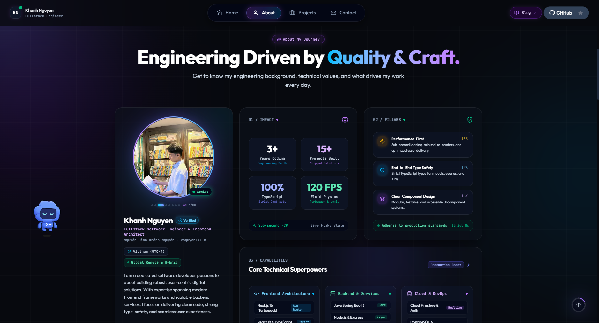
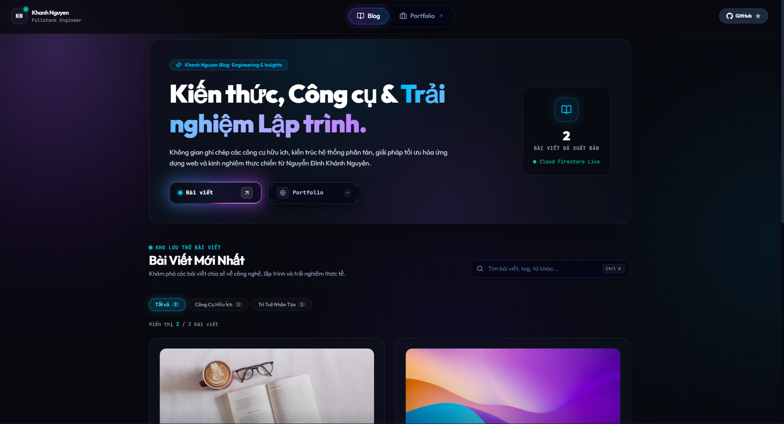
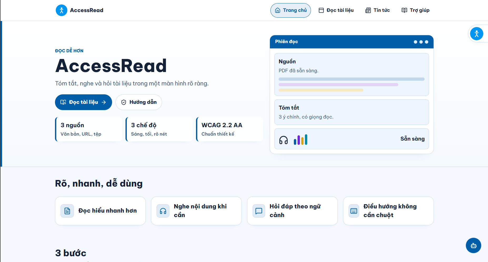
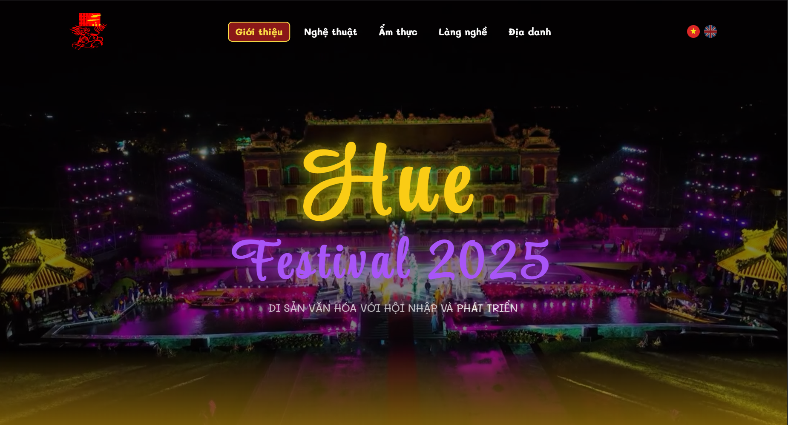
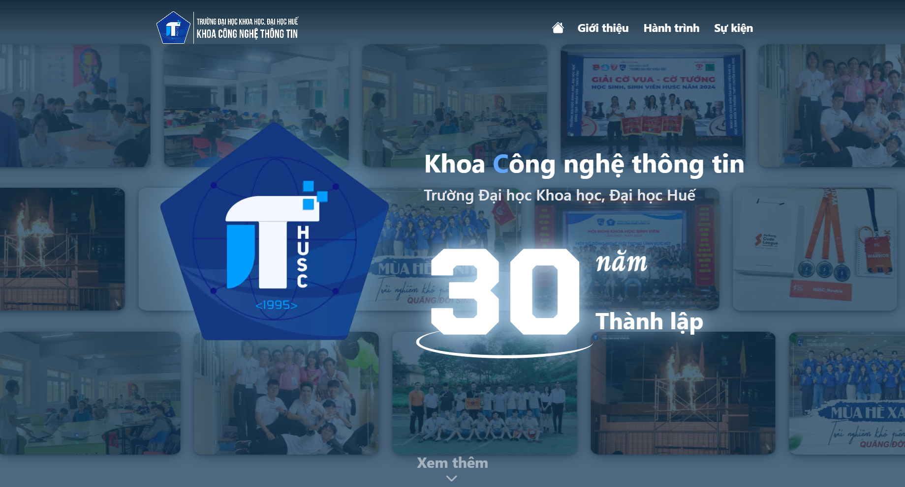
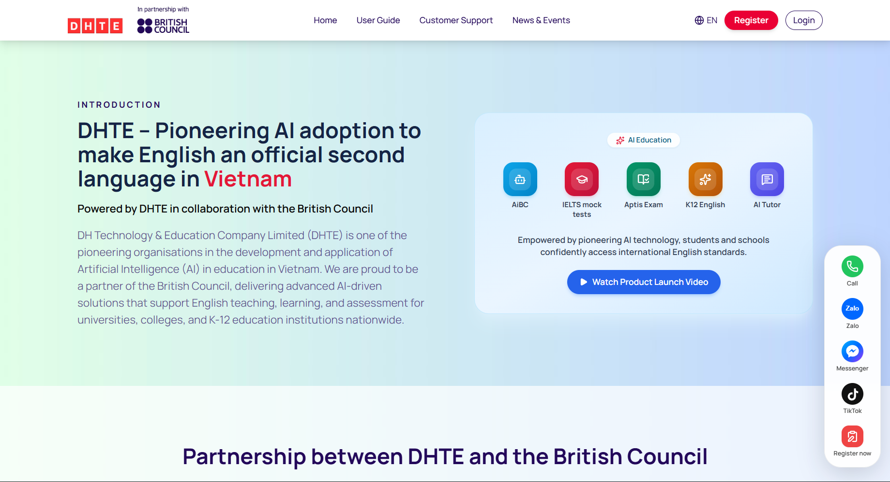

<h1 align="center">
  💞️ Hi, I’m <a href="https://ndknguyen.io.vn">Khánh Nguyên</a>
  
</h1>

  Fullstack Developer • Turning ideas into thoughtful web experiences

  Building fast, accessible applications with clean code and intuitive design.

  

  

  

  

  

---

## Tech Stack

  

---

## Featured Projects

<table>
  <tr>
    <td width="33%" align="center" valign="top">
      
      <h3>Portfolio</h3>
      
A personal website introducing my background, experience, and projects.

      
<a href="https://ndknguyen.io.vn">Website</a>

    </td>
    <td width="33%" align="center" valign="top">
      
      <h3>Personal Blog</h3>
      
A personal blog sharing programming knowledge, tools, and development experiences.

      
<a href="https://blog.ndknguyen.io.vn">Website</a>

    </td>
    <td width="33%" align="center" valign="top">
      
      <h3>AccessRead</h3>
      
Read, summarize, listen to, and ask questions about documents.

      
<strong>2nd Prize — WCAG 2.2 Website Design Competition</strong>

      
<a href="https://access-read.vercel.app">Website</a>

    </td>
  </tr>
  <tr>
    <td width="33%" align="center" valign="top">
      
      <h3>Hue Festival</h3>
      
Discover Hue Festival through local arts, cuisine, crafts, and landmarks.

      
<strong>1st Prize — SPIT Frontend 2025</strong>

      
<a href="https://huefestival.vercel.app">Website</a>

    </td>
    <td width="33%" align="center" valign="top">
      
      <h3>IT HUSC — 30th Anniversary</h3>
      
A landing page celebrating the 30th anniversary of IT HUSC.

      
<strong>1st Prize — IT HUSC 30th Anniversary Landing Page Competition</strong>

      
<a href="https://ithusc30.vercel.app">Website</a>

    </td>
    <td width="33%" align="center" valign="top">
      
      <h3>IELTSVTED (DHTE)</h3>
      
An online platform for IELTS preparation and practice tests.

      
<a href="https://dhte.org">Website</a>

    </td>
  </tr>
</table>

---

## Quote Of The Day

  

> _"Life and death are of supreme importance. Time swiftly passes by and opportunity is lost."_

  - Dogen

---

## Mini Game

  <picture>
    <source media="(prefers-color-scheme: dark)" srcset="https://raw.githubusercontent.com/knguyen1411b/knguyen1411b/github-breakout/images/breakout-dark.svg"/>
    <source media="(prefers-color-scheme: light)" srcset="https://raw.githubusercontent.com/knguyen1411b/knguyen1411b/github-breakout/images/breakout-light.svg"/>
    
  </picture>

  Last updated (UTC+7): <code>29/10/2026</code>

